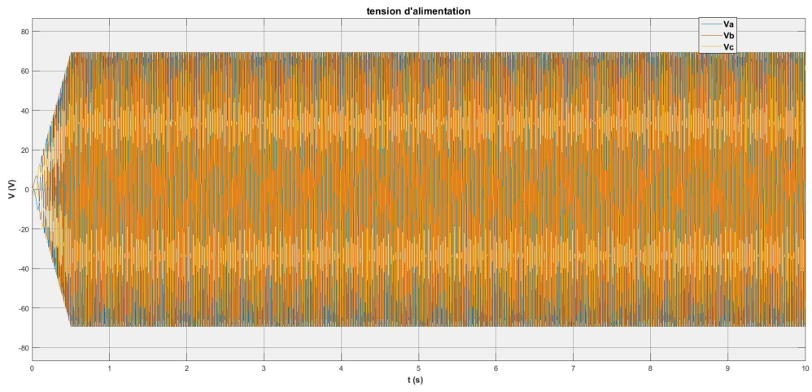
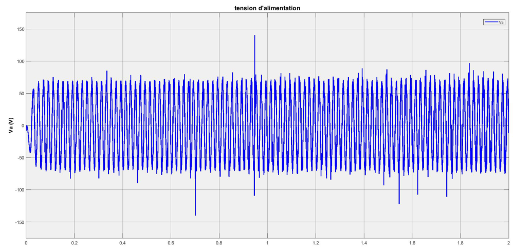

# Permanent Magnet Synchronous Generator

A MATLAB/Simulink study of a permanent-magnet synchronous generator under open-circuit and loaded conditions. The project uses the dq representation to examine electrical output and electromechanical behavior.

## What it does

- Models the generator's electrical and mechanical dynamics.
- Studies the voltage produced during startup and steady rotation.
- Examines stator currents, flux, speed and electromagnetic torque under load.

## Results

Figures from the [technical report](docs/permanent-magnet-generator-report.pdf).

### Open-circuit voltage



### Loaded generator voltage



## Tools

MATLAB, Simulink and Simscape Electrical Specialized Power Systems.

## Run

```matlab
generator_parameters
open_system('generator_open_circuit.slx')
```

Run the model and inspect its scopes. Use `generator_loaded.slx` and `generator_loaded_variant.slx` to explore loaded operation.

## Project files

| File | Purpose |
| --- | --- |
| `generator_parameters.m` | Electrical and mechanical parameters |
| `generator_open_circuit.slx` | Open-circuit study |
| `generator_loaded.slx` | Loaded generator |
| `generator_loaded_variant.slx` | Additional loaded configuration |

Developed as a collaborative academic engineering project.
