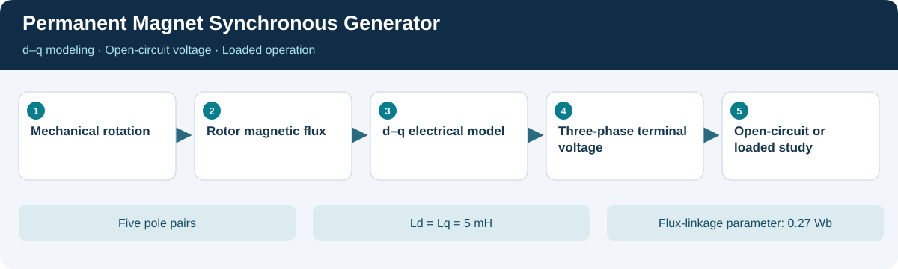
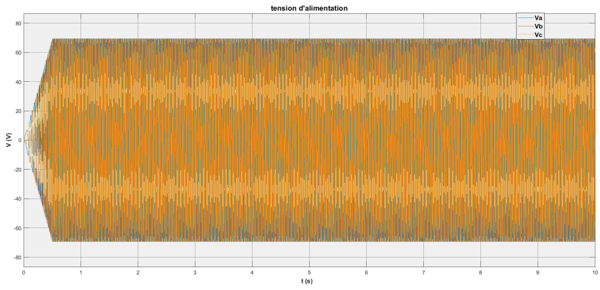
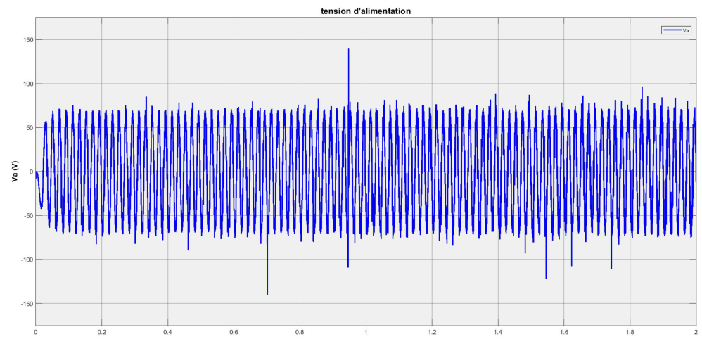

# Permanent Magnet Synchronous Generator

**d–q modeling · Open-circuit voltage · Loaded operation**

A MATLAB/Simulink model of a permanent-magnet synchronous generator. The study follows how mechanical rotation produces three-phase voltage and how the electrical and mechanical variables change when a load is connected.

Academic group project at the National Polytechnic School of Algiers.



## From rotation to electrical output

The permanent magnets establish rotor flux. Rotation changes the flux linked by the stator phases, inducing voltage. With an open circuit, the voltage can be observed without load current. With a connected load, stator current, voltage drops and electromagnetic torque enter the operating balance.

The project uses a rotating d–q frame to express the machine dynamics and compare open-circuit and loaded configurations.

## Parameter set

| Parameter | Value in `generator_parameters.m` |
|---|---:|
| Pole pairs | 5 |
| Stator resistance | 0.5 Ω |
| d-axis inductance | 5 mH |
| q-axis inductance | 5 mH |
| Permanent-magnet flux linkage | 0.27 Wb |
| Inertia | 1.15 × 10⁻³ kg·m² |
| Viscous friction coefficient | 5.9 × 10⁻⁵ N·m·s/rad |

Electrical and mechanical speed are related by:

$$\omega_e=p\omega_m$$

The d–q flux linkages are:

$$\lambda_d=L_di_d+\psi_f,\qquad\lambda_q=L_qi_q$$

Because the supplied parameter set has equal d- and q-axis inductances, the model emphasizes the permanent-magnet torque contribution. The induced-voltage scale increases with $\omega_e\psi_f$.

## Report results

### Open-circuit voltage



The phase voltages show how the generated waveform develops with rotation. Compare phase spacing, amplitude and the transition to the established operating condition.

### Loaded terminal voltage



The loaded study adds the influence of current and electromagnetic torque. Both figures come from the [technical report](docs/permanent-magnet-generator-report.pdf).

## Why separate models

An open-circuit model makes the voltage-generation mechanism easy to inspect. The loaded configurations then add the electrical power path and its interaction with mechanical dynamics. A shared parameter script keeps the machine definitions together while allowing each configuration to be explored independently.

## Run

```matlab
generator_parameters
open_system('generator_open_circuit.slx')
```

Run the model and inspect its voltage scopes. Then open `generator_loaded.slx` or `generator_loaded_variant.slx` to study loaded operation. Compare terminal voltage, stator current, electromagnetic torque and speed for the chosen case.

## Files and tools

| File | Role |
|---|---|
| `generator_parameters.m` | Electrical and mechanical data |
| `generator_open_circuit.slx` | No-load voltage study |
| `generator_loaded.slx` | Loaded generator |
| `generator_loaded_variant.slx` | Additional load configuration |
| [Report](docs/permanent-magnet-generator-report.pdf) | Model derivation and recorded figures |

**Tools:** MATLAB, Simulink and Simscape Electrical Specialized Power Systems.

## Related projects

[Induction Motor Direct Vector Control](https://github.com/MouaadO/induction-motor-vector-control) · [Electrical Machine Winding Simulator](https://github.com/MouaadO/electrical-winding-simulator)
